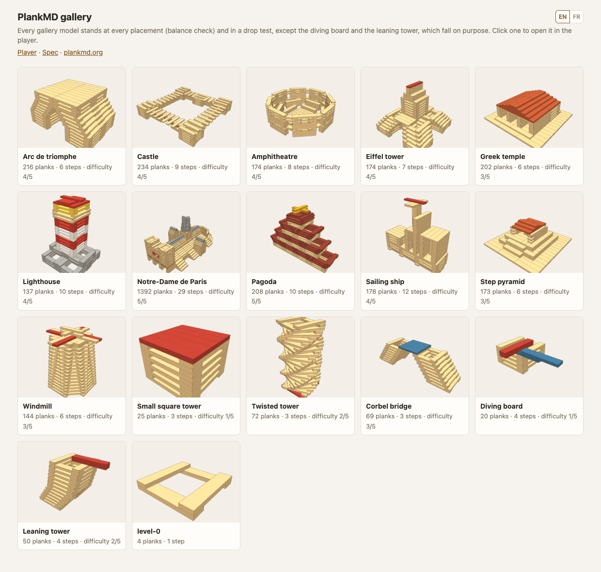

# PlankMD

> **Status:** Draft (v0.1), not yet stable.
>
> **Website:** [plankmd.org](https://plankmd.org), with the spec, the
> [player](https://plankmd.org/player/) and the [gallery](https://plankmd.org/gallery).

**PlankMD** is an open, Markdown-based format for constructions made of
identical wooden building planks, and for the steps to build them.

A `.plank.md` file is a 3D model and an instruction booklet at the same time:
one plank per line, one fenced block per building step, and plain Markdown
prose in between for the instructions. It is readable in any text editor,
diffs cleanly in Git, and is short and regular enough for a language model to
write and check.

````markdown
## Step 1: the first layer

Lay two planks flat and parallel, then two across them, on their ends.

```plank
flat-x 0 0 0
flat-x 0 12 0
flat-y 0 0 1
flat-y 12 0 1
```

## Step 2: build up the walls

```plank
flat-x 0 0 2  repeat=4 offset=0,0,2
flat-x 0 12 2 repeat=4 offset=0,0,2
flat-y 0 0 3  repeat=4 offset=0,0,2
flat-y 12 0 3 repeat=4 offset=0,0,2
```
````

Positions are counted in plank thicknesses (a plank is 15 × 3 × 1), so most
models only use small integers. The order of the lines is the order in which
the builder places the planks, and the validator checks every plank at the
moment it is placed: nothing goes through anything, and nothing floats.

Gaps are measured the way builders measure them, with planks used as rulers:
a `guide` line is a ghost plank shown during its step only. It tells the
builder how much space to leave, and the validator checks that the space is
right.

```plank
guide flat-x 0 3 0 repeat=3 offset=0,3,0   # leave three plank widths between the walls
flat-x 0 0 0
flat-x 0 12 0
```

## Gallery

[`gallery/`](./gallery/) holds eleven larger models (CC0): a castle, a lighthouse,
a pagoda, a sailing ship, a windmill, an amphitheatre, four landmarks
(an Eiffel-style tower, a step pyramid, a Greek temple, a triumphal arch),
and Notre-Dame de Paris, 1392 planks in 29 steps.
Each one stands at every placement in the balance check and in the drop
test (`npm run check:gallery`). Open `player/gallery.html` to browse them.



## What is in this repository

| Path | What it is |
|---|---|
| [`SPEC.md`](./SPEC.md) | The format specification |
| [`docs/llm-instructions.md`](./docs/llm-instructions.md) | A ready-to-use system prompt for writing PlankMD with an LLM |
| [`src/plankmd.js`](./src/plankmd.js) | Reference implementation: parse, expand, validate. No dependencies, Node and browser |
| [`bin/plankmd.js`](./bin/plankmd.js) | Command-line validator |
| [`src/physics.js`](./src/physics.js) | Balance check: does it stand at every placement, and how much tilt does it withstand? Optional, needs [HiGHS](https://highs.dev) |
| [`src/drop.js`](./src/drop.js) | Drop test: a physics engine ([Rapier](https://rapier.rs)) lets gravity act on the model |
| [`gallery/`](./gallery/) | Eleven larger models, checked for balance |
| [`site/`](./site/) | Source of [plankmd.org](https://plankmd.org) (VitePress) |
| [`player/`](./player/) | A 3D player: steps, plank-by-plank replay, live editing, diagnostics, balance check and drop test |
| [`samples/`](./samples/) | Example models (CC0): square tower, twisted tower, corbel bridge, and two models that fall on purpose: a diving board (at step 3) and a leaning tower (when its flag goes on top) |
| [`test/cases/`](./test/cases/) | Small models with a known verdict (stands or falls), shared by every balance checker |

## Quick start

**See a model.** Open `player/index.html` in a browser, pick a sample, or drop
your own `.plank.md` file on the scene. Edit the source on the left, and the
model and the diagnostics update as you type. `player/index.html?src=<url>`
loads a model from the web, and
[`plankmd.org/p?repo=<GitHub address>`](https://plankmd.org/use#share-your-models-from-github)
opens every model of a GitHub repository, in the browser only. The player
speaks English and French (EN/FR switch, or `?lang=fr`).

**Validate a model.** With [the npm package](https://www.npmjs.com/package/plankmd),
`npx plankmd validate model.plank.md`; in a clone of this repository:

```bash
node bin/plankmd.js validate samples/*.plank.md
```

```
✓ samples/corbel-bridge.plank.md: 45 planks, 3 steps, 0 errors, 0 warnings
```

Each diagnostic names its line and its plank number, for example
`model.plank.md:31: W-floating plank 12 ("flat-y 0 0 3") rests on nothing
when it is placed`. Add `--json` for machine-readable output and `--strict`
to fail on warnings. `node bin/plankmd.js expand <file>` lists every plank in
placement order.

**Check that it stands.** `--physics` adds a balance check: after every
plank placed, can the construction stand? And at the end of every step, how
much can the table tilt before it falls?

```bash
npm install          # installs the optional solver, HiGHS
node bin/plankmd.js validate samples/corbel-bridge.plank.md --physics
```

```
samples/corbel-bridge.plank.md: step 3 stands, withstands a 9.7° tilt (towards +x)
✓ samples/corbel-bridge.plank.md: 69 planks, 3 steps, 0 errors, 0 warnings, stands
```

It models planks as rigid blocks resting on each other, with friction
(rigid-block equilibrium, solved as a linear program). It is conservative:
planks pressed side by side get no help from friction. Its findings are
reported as information (`I-unstable`, `I-fragile`), never as errors: they
are not part of the format. In the player, tick **Check balance** to run the
same check in the background. It is off by default, as it keeps a processor
core busy: the verdict (stands, or falls from plank N) comes within a second
or two even on 200 planks, then the tilt of each step follows, step by step,
in up to half a minute.

A physics engine gives a second opinion, and shows the fall: **Drop test**
drops the planks shown all at once, **Replay build** puts them down one by
one in building order and stops on the first placement that makes the
construction move. Both run in the player, in slow motion, and on the command
line (`node bin/plankmd.js drop <file>`). The balance check and the engine are
validated against each other on [`test/cases/`](./test/cases/).

**Use it as a library.**

```js
const PlankMD = require('./src/plankmd.js'); // or window.PlankMD in a browser
const { valid, planks, steps, diagnostics } = PlankMD.validate(text);
```

**Generate models with an LLM.** Give the model
[`docs/llm-instructions.md`](./docs/llm-instructions.md) as its system prompt,
ask for a construction, run the validator on the result, and send the
diagnostics back until it is clean.

**Run the tests.** `npm test` (Node 18 or later). Without `npm install`, the
balance and drop tests are skipped and the rest runs with no dependency.

## Compatibility

Compatible with KAPLA® planks: the default plank size (`plank: [15, 3, 1]`,
`unit_mm: 7.8`) matches them. Any other planks work too: declare their
proportions in the frontmatter.

KAPLA® is a registered trademark of its owner. PlankMD is an independent
project; it is not affiliated with, sponsored or endorsed by the trademark
owner.

## Design

PlankMD follows the design principles of [LearnSpec](https://learnspec.org),
an open suite of Markdown formats for learning: Markdown-first, file-native,
progressive levels (Level 0 is one block of four numbers per line), and built
to be generated and consumed by AI systems.

## License

[MIT](./LICENSE) for the specification, the code, the website and the logo.
The models (`samples/`, `gallery/`, `test/cases/`) are released under CC0.
The optional solvers keep their own licenses: HiGHS is MIT, Rapier is
Apache-2.0.
